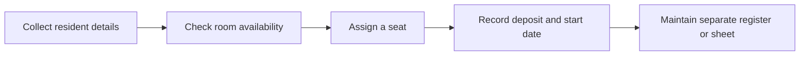
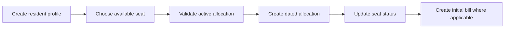
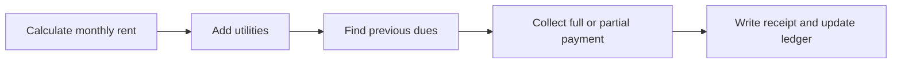
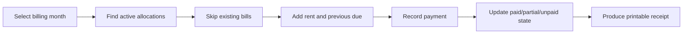
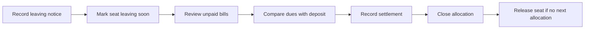

# As-Is and To-Be workflows

## Evidence note

No formal observation of the previous operating process was found. The As-Is flows below are **INFERRED** from the documented requirements and should be validated with the property owner and manager.

## 1. Resident admission and seat allocation

### As-Is — reconstructed

Risks inferred from the requirement set include duplicate allocation, inconsistent identifiers, and loss of history when a seat changes residents.

### To-Be — implemented workflow

Status: **VERIFIED in implementation structure; runtime workflow not end-to-end tested for this publication.**

## 2. Monthly billing and collection

### As-Is — reconstructed

### To-Be — implemented workflow

Manual bill generation is **VERIFIED**. Automatic scheduling is **DOCUMENTED but UNVERIFIED**.

## 3. Notice, checkout, and deposit settlement

### To-Be — implemented workflow

The calculation path exists in implementation. Accounting correctness and exception handling have not been dynamically validated.

## Proposed improvements

- Validate the reconstructed As-Is workflows with real operators.
- Add transactional guarantees around multi-step financial and allocation updates.
- Introduce a formal correction/void approval workflow.
- Create an anonymized training/demo environment for repeatable acceptance tests.
