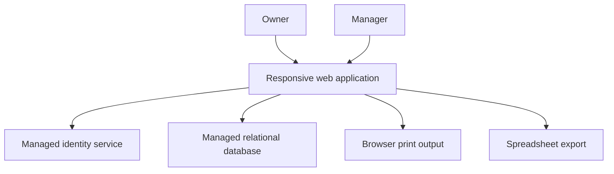
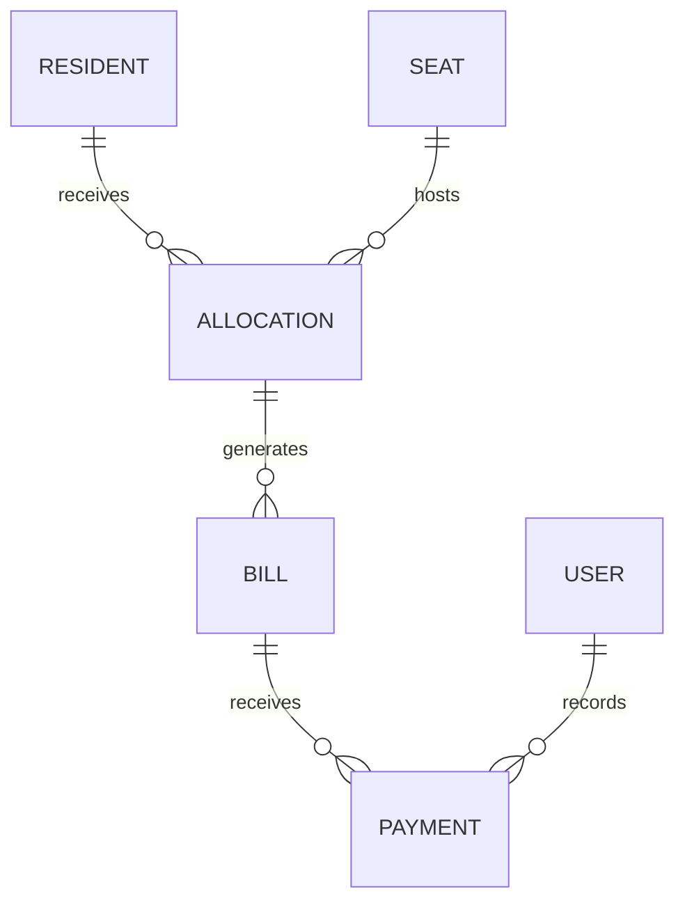

# Architecture overview

## System context

The application is a Next.js 16.4.3 App Router project using TypeScript and React. Server-rendered pages and server operations communicate with a managed PostgreSQL-backed service that also provides authentication.

## Logical domains

This diagram intentionally omits column names, private identifiers, policies, and complete schema details.

## Application layers

| Layer | Responsibility |
| --- | --- |
| Presentation | Operational dashboard, forms, tables, charts, receipts, responsive navigation |
| Server operations | Validation, orchestration, billing/payment/allocation mutations, cache revalidation |
| Identity and authorization | Authenticated session, role resolution, selected owner checks |
| Data | Relational records, constraints, row-level policies, history |
| Client output | Browser printing and spreadsheet generation |

## Data integrity mechanisms

- Relational references connect allocations, bills, payments, and users.
- Allowed status and payment values are constrained.
- Monthly bills use an allocation-and-month uniqueness rule.
- Application checks attempt to prevent duplicate active resident or seat allocations.
- Payment input rejects non-positive and over-due values in the normal collection flow.

These controls reduce risk but do not replace concurrency, transaction, authorization, and automated test coverage.

## Security boundary

The browser, server runtime, identity provider, and database form separate trust boundaries. Current static review indicates that role enforcement is stronger in some application operations than in the general database policy set. The intended future state is defense in depth: UI restrictions, authenticated server authorization, least-privilege database policies, audit records, and repeatable security tests.

## Deployment posture

Managed hosting and database services are documented, but this publication did not validate the live deployment, project identifiers, quotas, or configuration. Those details are deliberately excluded.
