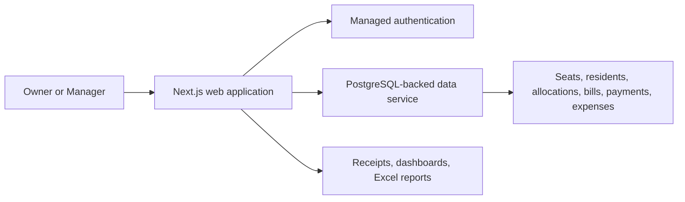

# SmartMess case study

## Executive summary

SmartMess addresses the operational complexity of running a hostel or student mess where room capacity, individual seats, resident turnover, recurring rent, partial payments, arrears, deposits, and receipts must remain connected over time.

The implementation uses a web interface backed by a relational cloud data service. Instead of attaching a resident permanently to a seat, it records time-bounded allocations. This supports turnover history and allows billing and collection records to remain associated with the relevant resident and seat period.

**Evidence classification:** the existence of the implemented modules and successful production build are **VERIFIED**. The original business need and client deployment are **DOCUMENTED**. Business outcomes and adoption are **UNKNOWN**.

## Problem and context

The recorded product objective was to replace fragmented operational work with one system for:

- configuring rooms and seats;
- enrolling residents and recording relevant profile information;
- allocating and releasing seats without losing historical context;
- generating monthly bills and carrying forward unpaid balances;
- recording partial or full payments and producing receipts;
- tracking operational expenses;
- reviewing occupancy, collections, dues, and yearly seat-level history.

The exact pre-system process was not captured through a formal stakeholder interview. The As-Is description in this package is therefore a reconstructed analysis, not claimed field research.

## Users and stakeholders

Two authenticated operating roles are documented: an Owner and a Manager. Residents or students are business subjects whose profiles, allocations, bills, and payments are managed; there is no verified resident self-service portal.

The Owner is intended to control sensitive settings and selected destructive operations. The Manager is intended to handle daily enrollment, allocation, collection, and receipt workflows. Static review found that this role separation is only partially and inconsistently enforced across application and database layers, so the intended RBAC model is not represented as fully verified.

## Product approach

The repository history shows a rapid foundation-to-operations sequence:

1. Application foundation, authentication, relational schema, and dashboard.
2. Seat inventory, resident profiles, and allocation turnover.
3. Billing, payment collection, printable receipts, and yearly reporting.
4. Branding, usability, responsive layout, and expense management.
5. Session inactivity handling, troubleshooting, and framework security upgrade.

This sequence is reconstructed from 27 commits dated 9–29 October 2026. Commit messages are evidence of change history, not proof that every claimed behavior was tested.

## Architecture at a glance

The public diagram is intentionally high level. Credentials, deployment identifiers, private endpoints, complete schema details, and security-sensitive operational instructions are excluded.

## Key product and engineering decisions

### Time-bounded seat allocation

**VERIFIED implementation; rationale partly reconstructed.** A separate allocation history connects residents and seats over time. This avoids overwriting earlier occupancy context when a seat changes hands.

### Duplicate monthly bill prevention

**VERIFIED implementation.** Monthly billing uses an allocation-and-month uniqueness rule and checks existing records before creating a new bill.

### Manual billing fallback

**VERIFIED implementation.** An operator-triggered monthly generation flow exists. Automatic scheduled generation is documented but was not found as an implemented scheduler.

### Browser-based reporting and backup

**VERIFIED implementation, runtime behavior not fully exercised.** Yearly matrix and backup flows use client-side spreadsheet generation. PDF export is documented but not verified in implementation.

### Free-tier managed services

**DOCUMENTED decision.** Project material records a managed hosting and database strategy intended to reduce operating cost. No financial feasibility calculation or current vendor-limit verification was found.

## Validation performed for this publication

- Private repository inventory and static implementation review: completed.
- Git history review: completed.
- Production build with Next.js 16.4.3 and TypeScript validation: passed on 6 November 2026.
- Dependency audit: completed; unresolved findings remain and are summarized in the limitations report.
- Full lint run: attempted but did not complete within the observation window; not claimed as passed.
- Automated unit/integration/E2E tests: none found.
- Authenticated workflow testing against a safe demo dataset: not performed.
- Screenshot review: captured output contained a property identifier and was withheld.

## Outcomes and limitations

The repository demonstrates delivery of a broad operational workflow and continued iteration through bug fixes, UX refinements, session handling, and a framework security upgrade. No defensible evidence was found for adoption, time saved, revenue impact, error reduction, customer satisfaction, or ROI. Those outcomes remain unknown rather than estimated.

The strongest next steps are to establish a sanitized demo environment, add automated tests for money and turnover rules, resolve dependency findings, harden authorization at the database and server-action layers, and then capture approved workflow screenshots.
